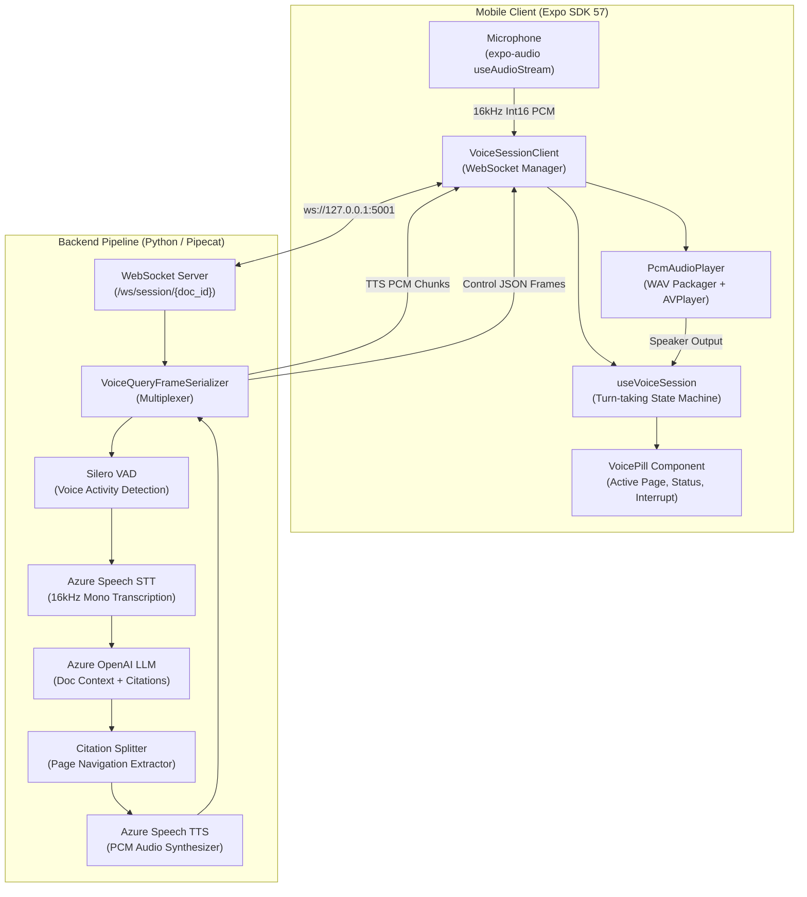
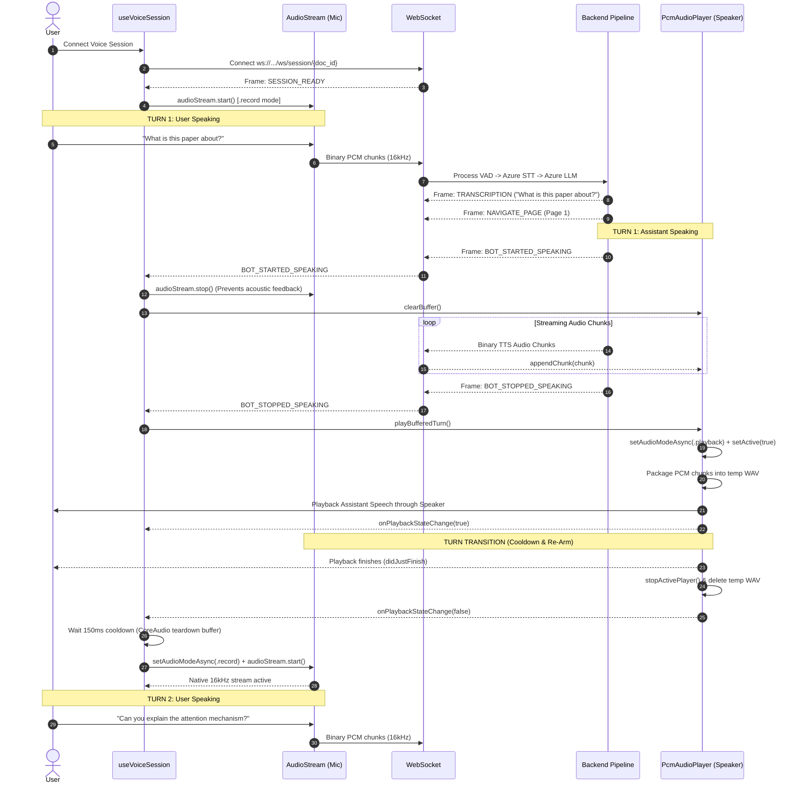

# Real-Time Voice Pipeline & Audio Architecture

This document serves as the **Source of Truth (SoT)** for VoiceQuery's real-time voice intelligence architecture, bidirectional WebSocket protocol, and native iOS CoreAudio session lifecycle.

---

## 1. System Overview

VoiceQuery delivers conversational document intelligence through a full-duplex WebSocket connection between the Expo React Native mobile client and a Pipecat-powered Python backend.

> 🔗 **Interactive Visual**: [Open System Architecture in Lucidchart](https://lucid.app/lucidchart/5a4351aa-e769-4cc2-9026-fb92c768449c/edit?invitationId=inv_294a2d0b-7274-478f-ae0e-846bd69df6c1)



---

## 2. Bidirectional Frame Protocol

The WebSocket connection (`ws://<host>:<port>/ws/session/<doc_id>?page=<initial_page>`) multiplexes **raw binary audio streams** and **JSON control frames** over a single socket channel.

### Binary Frames
| Direction | Format | Description |
|---|---|---|
| **Client $\to$ Server** | 16kHz, 1-channel, 16-bit signed PCM (`int16`, little-endian) | Raw microphone stream from device. |
| **Server $\to$ Client** | 16kHz, 1-channel, 16-bit signed PCM (`int16`, little-endian) | Synthesized assistant speech chunks generated by Azure TTS. |

### JSON Control Frames
| Direction | Event Name | Payload Example | Purpose |
|---|---|---|---|
| **Server $\to$ Client** | `SESSION_READY` | `{"type": "SESSION_READY", "doc_id": "...", "page_count": 2, "active_page": 1}` | Informs client that pipeline worker is running and document index is loaded. |
| **Server $\to$ Client** | `NAVIGATE_PAGE` | `{"type": "NAVIGATE_PAGE", "page": 2, "quote": "..."}` | Emitted when assistant cites a specific page; navigates PDF viewer. |
| **Server $\to$ Client** | `TRANSCRIPTION` | `{"type": "TRANSCRIPTION", "role": "user", "text": "..."}` | Real-time transcript of the user's spoken question for UI display. |
| **Server $\to$ Client** | `BOT_STARTED_SPEAKING` | `{"type": "BOT_STARTED_SPEAKING"}` | Signals incoming assistant speech. Client stops mic and clears buffer. |
| **Server $\to$ Client** | `BOT_STOPPED_SPEAKING` | `{"type": "BOT_STOPPED_SPEAKING"}` | Signals all TTS chunks for turn are sent. Client begins WAV playback. |
| **Server $\to$ Client** | `INTERRUPT` | `{"type": "INTERRUPT"}` | Sent when VAD detects interruption. Client immediately halts playback. |
| **Client $\to$ Server** | `SET_READING_POSITION`| `{"type": "SET_READING_POSITION", "page": 3}` | Synchronizes user scrolling position to update LLM RAG bias. |
| **Client $\to$ Server** | `INTERRUPT` | `{"type": "INTERRUPT"}` | Client requests immediate cancellation of server speech generation. |

---

## 3. Turn-by-Turn Conversational Sequence

> 🔗 **Interactive Visual**: [Open Turn Sequence Diagram in Lucidchart](https://lucid.app/lucidchart/d566f9b8-14f9-4e22-ae14-113b91dae44b/edit?invitationId=inv_62710536-380c-4005-8661-d7d08c4419f7)



---

## 4. Native iOS Audio Architecture & Invariants

Interfacing `AVAudioEngine` (input recording) and `AVPlayer` (output playback) in React Native requires strict adherence to iOS AVFoundation constraints.

### The Category Conflict (`.record` vs `.playback`)
- **Microphone Stream (`expo-audio`'s `AudioStream.swift`)**:
  - Sets `AVAudioSession.sharedInstance().setCategory(.record, mode: .measurement)`.
  - **Apple Invariant**: `AVAudioSessionCategoryRecord` **strictly silences audio playback**. If `AVPlayer.play()` is invoked while in `.record` category, no sound will emit from the device speakers.
  - When `audioStream.stop()` is called, `AudioStream.swift` executes `session.setActive(false)`.

- **Speech Playback (`PcmAudioPlayer.ts`)**:
  - Before calling `AVPlayer.play()`, the player must explicitly configure:
    ```ts
    await setAudioModeAsync({
      playsInSilentMode: true,
      allowsRecording: false,
      interruptionMode: "duckOthers",
      shouldRouteThroughEarpiece: false,
    });
    await setIsAudioActiveAsync(true);
    ```
  - This transitions the category from `.record` $\to$ `.playback` and re-activates the hardware session.

### Suppressing Delayed Deactivation (`keepAudioSessionActive: true`)
- By default, `createAudioPlayer(uri)` sets `keepAudioSessionActive: false`. When playback completes, `AudioModule.swift` launches an asynchronous background `Task` with a 100ms sleep that invokes:
  ```swift
  AVAudioSession.sharedInstance().setActive(false, options: [.notifyOthersOnDeactivation])
  ```
- If the client attempts to re-arm the microphone during or after that 100ms window, the delayed task deactivates the session beneath the newly started `AudioStream`, causing crashes.
- **Rule**: Always pass `{ keepAudioSessionActive: true }` to `createAudioPlayer`:
  ```ts
  const player = createAudioPlayer(tempFile.uri, {
    keepAudioSessionActive: true,
  });
  ```

### Hardware Teardown Cooldown (150ms Buffer)
- When `status.didJustFinish` fires, `AVPlayer` has not completely released CoreAudio's output audio unit.
- If `audioStream.start()` is invoked synchronously in the same event tick, CoreAudio throws:
  `com.apple.coreaudio.avfaudio error 560227702` (`AVAudioSessionErrorCodeCannotInterruptOthers`, hex `0x21636174` = `'!cat'`).
- **Rule**: Implement a 150ms teardown buffer in `useVoiceSession` before switching back to `.record` and calling `audioStream.start()`:
  ```ts
  rearmTimerRef.current = setTimeout(() => {
    if (statusRef.current === "connected" && !isSpeakingRef.current) {
      startRecordingRef.current?.();
    }
  }, 150);
  ```

---

## 5. Acoustic Feedback & Half-Duplex Turn Taking

Without native Acoustic Echo Cancellation (AEC) across custom audio session categories:
- If the device microphone remains open while synthesized speech plays through the loudspeaker, the mic captures the assistant's voice and streams it back to the server.
- The server's Silero VAD triggers on the assistant's own voice, misinterpreting it as user interruption and cutting speech after the first word.
- **Enforced Half-Duplex Strategy**:
  1. `BOT_STARTED_SPEAKING` immediately calls `stopRecording()`.
  2. The input audio stream is paused while the assistant speaks.
  3. The mic only re-arms after playback completes or the user explicitly taps **Interrupt** on the `VoicePill`.

---

## 6. Verification & Health Checks

Whenever modifying audio streaming or voice session logic:
1. **Typecheck Client**:
   ```bash
   pnpm --filter @voice-query/client exec tsc --noEmit
   ```
2. **Lint Server**:
   ```bash
   uv run --directory server ruff check .
   ```
3. **Multi-Turn Verification Test**:
   - Speak Turn 1 $\to$ verify assistant audio plays out loud.
   - Wait for turn to finish $\to$ verify UI returns to `Listening • P.1` without crashing (`error 560227702`).
   - Speak Turn 2 $\to$ verify server logs receive audio and generate Turn 2 answer.
